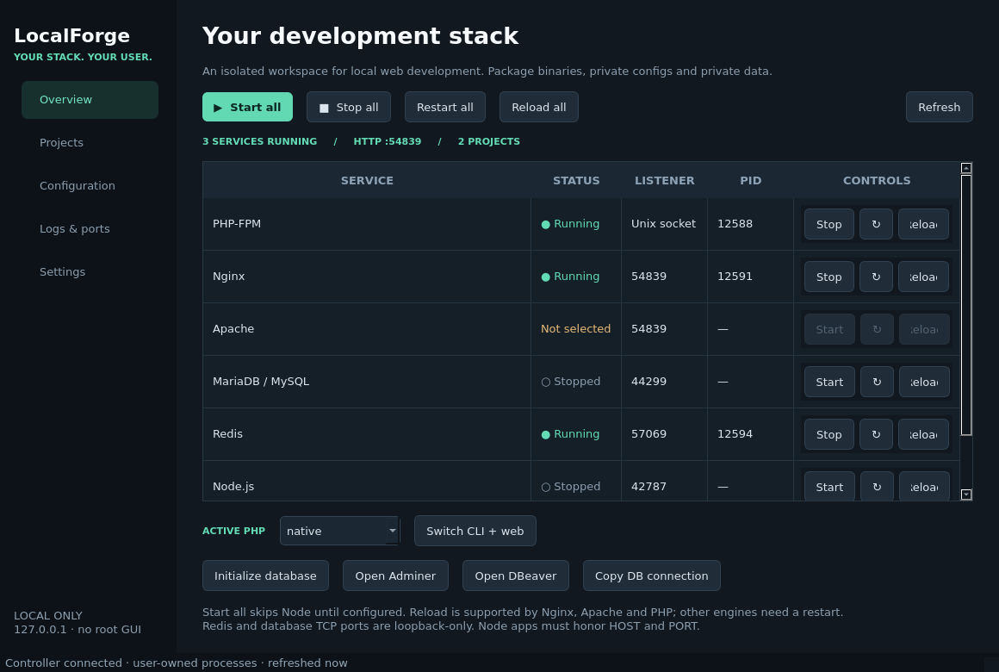

# LocalForge
### Native Linux development environments, owned by your user

**Python + PySide6 · Nginx / Apache · switchable PHP-FPM · MariaDB / MySQL · Redis / Valkey · Node.js**

LocalForge is a working source implementation of a Laragon-style Linux desktop manager. It uses native executables with private configs, sockets, logs and data—not containers, system PHP alternatives or root-run GUIs.

> **Release status: 0.1.2 / developer preview.** Native process integration tests pass in a Debian 13 sandbox. The Arch and Fedora installers are provided but have not been executed on those distributions. Treat distro compatibility as a target awaiting VM validation, not a certification. Legacy PHP binaries and DBeaver are not bundled. A pinned Adminer web database manager is included.



## Install

From an extracted source checkout, **as your desktop user**:

```bash
# Arch Linux (performs a full pacman upgrade to avoid partial upgrades)
./install-arch.sh

# OR Fedora
./install-fedora.sh

# Launch from your application menu or:
~/.local/bin/localforge-gui
```

Review the installer before running it. Packages and the tightly-scoped hosts helper require `sudo`; application code installs into a private virtual environment. A graphical polkit authentication agent is required for hostname changes. First install needs internet access to obtain Python wheels.

The scripts install current distro PHP and both web servers, not four conflicting system PHP packages. Register other PHP versions from independent prefixes; see [runtime setup](docs/RUNTIMES.md). On Fedora, Valkey is used when Redis is unavailable in enabled repositories. Optional DBeaver can be installed separately, for example through your existing Flatpak setup:

```bash
flatpak install flathub io.dbeaver.DBeaverCommunity
```

No machine-wide service is automatically stopped to free ports. If another MySQL or Redis already owns 3306 or 6379, open **Settings → Edit ports** and choose other values.

## First workspace

1. Open **Overview → Initialize database**. Only an empty LocalForge datadir is accepted.
2. Make a project in `~/www/my-app/` (or use **Projects → New project**).
3. New directories are detected every five seconds. `public/` is preferred as the document root.
4. Choose **Sync /etc/hosts…** and authorize the scoped change. DNS updates are deliberately not silently escalated.
5. Click **Start all**. Visit `http://my-app.test:8080`.

A minimal project:

```bash
mkdir -p ~/www/my-app/public
printf '%s\n' '<?php echo "Hello from PHP ".PHP_VERSION;' > ~/www/my-app/public/index.php
```

`Start all` independently starts available services and reports failures without rolling back healthy ones. Node is skipped until configured. Missing runtimes and uninitialized databases produce actionable errors. Closing the window hides it to the tray when available; quitting the GUI leaves services under the user controller. **Stop all** stops only managed child processes.

## Features

| Area | Implementation |
|---|---|
| Native GUI | Five pages: Overview, Projects, Configuration, Logs & ports, Settings; system tray when supported |
| Lifecycle | Start / stop / restart per service or all; asynchronous GUI IPC; status every 2.5 seconds |
| Reload | Nginx HUP, Apache graceful USR1, PHP-FPM USR2; Redis/database/Node report restart required |
| Ports | Editable unprivileged ports; actual bind checks; `ss -ltnp` inventory; foreground readiness checks |
| Config | In-app editors for `nginx.conf`, `httpd.conf`, versioned `php.ini`, `my.cnf`, Redis and persistent overrides; read-only hosts view |
| Projects | Automatic directory discovery, generated `.test` vhosts, `public/` preference, live checked reload of vhost includes |
| Name resolution | Explicit one-click polkit helper maintains a UID-scoped `/etc/hosts` block; optional DNS setup documented |
| PHP | `.php-version` project overrides with supervised versioned FPM sockets; registered CLI/FPM pairs; private ini and extension scan directory per runtime; private shell shim; rollback on failed switch |
| Database | Private MariaDB initialization/socket authentication; optional MySQL mode; bundled offline Adminer at `http://localhost:8080/_adminer`; optional native/Flatpak DBeaver launcher |
| Supervision | systemd **user** unit or standalone same-UID Unix-socket controller; never arbitrary PID-file killing |
| Packaging | Arch/Fedora dependency installers, desktop entry, icon, user unit, root-owned helper and polkit action |

## Project PHP versions and Adminer

Write a registered runtime label to the **project root's** `.php-version`:

```bash
printf '%s\n' '8.2' > ~/www/my-app/.php-version
```

LocalForge detects the change, starts that label's private FPM instance and reloads the virtual host. Absent, unreadable or unregistered labels fall back to the active global version. Global CLI switching remains independent of pinned project web runtimes. PHP binaries are still supplied separately. See [v0.1.2 behavior and upgrade notes](docs/V0.1.2.md).

After starting the web server/PHP and database, choose **Overview → Open Adminer**. The built-in UI runs on the global PHP runtime and requires a password-protected database account (the OS-user socket account is not a web login). The MySQL server field should be `127.0.0.1:3306` or your configured port. No download is needed to install Adminer itself. See [runtime setup](docs/RUNTIMES.md) for database extensions and credentials.

## CLI

```bash
localforge status
localforge start-all
localforge stop-all
localforge restart nginx
localforge reload php
localforge check nginx
localforge scan
localforge sync-hosts
localforge discover
localforge php 8.3           # label must already be registered
localforge tail nginx.log
localforge init-db
```

Complete settings can be exported and reapplied without changing `/etc` service configs:

```bash
localforge status > status.json
python3 -c 'import json; print(json.dumps(json.load(open("status.json"))["settings"], indent=2))' > workspace.json
# Stop services, edit workspace.json, then:
localforge apply workspace.json
```

To use the selected CLI PHP in your shell, explicitly opt into the private shim:

```bash
export PATH="${XDG_DATA_HOME:-$HOME/.local/share}/localforge/bin:$PATH"
php --version
```

The application does **not** modify `.bashrc`, `update-alternatives`, `/usr/bin/php` or system package dependencies. After a switch, PHP requests in flight can fail briefly; this is a coordinated restart, not zero-downtime deployment.

## Layout and documentation

- [Architecture and complete directory layout](docs/ARCHITECTURE.md)
- [PHP, database and Node runtime configuration](docs/RUNTIMES.md)
- [DNS, ports, security and Fedora troubleshooting](docs/OPERATIONS.md)
- [Validation results and release limitations](docs/VALIDATION.md)

```text
localforge/
├── localforge/          # GUI, controller, CLI, config/rendering and IPC
├── packaging/          # Narrow privileged helper, polkit policy, desktop icon
├── scripts/            # Shared install logic, uninstall and GUI smoke test
├── install-arch.sh
├── install-fedora.sh
├── tests/              # Unit + opt-in native engine / Unix IPC integration tests
├── docs/
└── pyproject.toml
```

## Develop / validate

```bash
python3 -m venv .venv
. .venv/bin/activate
pip install -e .
localforge-gui

python -m unittest discover -s tests -v
# Requires the actual engine packages; does NOT use your system datadirs:
LOCALFORGE_INTEGRATION=1 python -m unittest discover -s tests -v
QT_QPA_PLATFORM=offscreen python scripts/gui-smoke.py
```

Headless backend and tests use only the standard library; importing the engine never requires Qt.

## Why LocalForge instead of Laragon on Linux?

Laragon is widely loved on Windows for its zero-config workflow, automatic virtual hosts, and native speed. However, Laragon is strictly Windows-only. Linux developers are often forced into heavy Docker setups (DDEV, Sail) or dated XAMPP packages.

LocalForge brings the authentic Laragon experience to Linux:
- **No Docker Overhead:** Runs lightweight native distro binaries directly under your user account.
- **Identical Workflow:** Drop a folder into `~/www/` and immediately get a clean `.test` domain.
- **Multi-PHP Support:** Switch global versions or set per-project `.php-version` files.
- **Integrated Database Tool:** Bundled web database management via Adminer.

## Third-party notice

Bundled Adminer 6.1.2 is redistributed unchanged under Apache License 2.0, separate from LocalForge’s MIT license. The source package and wheel include its [provenance notice](localforge/assets/ADMINER-NOTICE.md) and full license.

## Scope and safety

This is **configuration/data/process isolation**, not a security sandbox. Code in PHP or Node runs as you and can access your files. Default generated listeners are IPv4 loopback-only, but your edits or application code can change that. Do not serve untrusted code or expose end-of-life PHP versions to the network.

Binary discovery includes `/usr/libexec` and `/usr/lib` as well as sbin directories. Apache runs with explicit numeric directives for the invoking effective UID and GID. Missing or overlong XDG runtime socket paths fall back to a verified mode-0700 `/tmp/lf-<uid>` directory.

Default pretty URLs include `:8080`. This release intentionally does not install root port-forwarding rules, grant capabilities to interpreters, configure HTTPS or alter global resolver settings. The safe polkit helper handles hosts only; it cannot execute commands or bind privileged ports. Use the documented optional DNS setup if wildcard `.test` resolution is needed.

Uninstall registrations with `./scripts/uninstall.sh`; your databases, configs and runtimes are preserved. Remove your hosts block first by syncing an empty project list. The shared root helper is not automatically removed while other users may need it.

MIT licensed. No affiliation with Laragon or the managed runtime projects.
